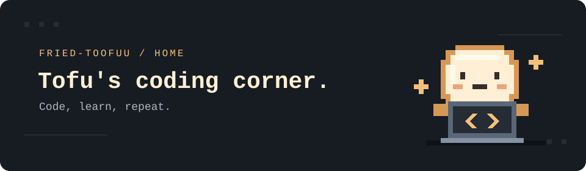
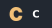
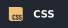
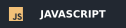
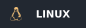

  

<h1 align="center">Hi, I'm Khanh &#128075;</h1>

  <strong>Currently studying at PTIT Hanoi </strong> 

<h3 align="center">Let's connect</h3>

  
  

  

<h3 align="center"> Coding Gear</h3>

  
  
  
  

<h3 align="center"> Web &amp; Database</h3>

  
  
  
  
  

<h3 align="center"> Creative Gear</h3>

  
  

<h3 align="center"> Everyday Tools</h3>

  
  
  
  

  <picture>
    <source media="(prefers-color-scheme: dark)" srcset="assets/contribution-snake-dark.svg" />
    
  </picture>

<!-- Snake images are refreshed daily by .github/workflows/contribution-snake.yml. -->

  
   
  one small commit at a time.

