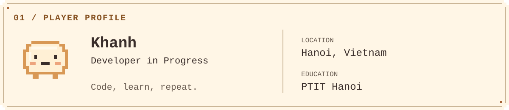
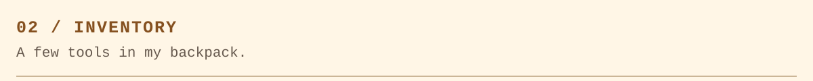
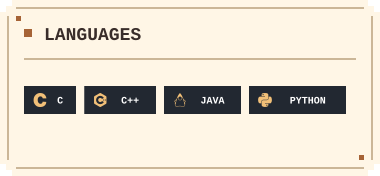
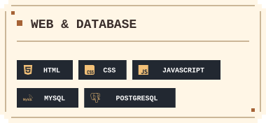
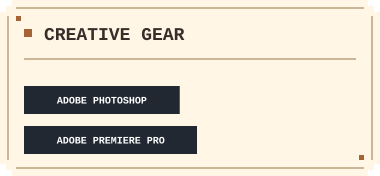
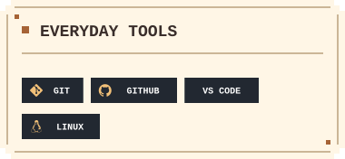
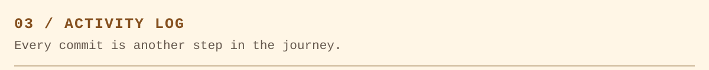

<!-- Artwork: python scripts/build-pixel-world.py. Maintenance: docs/profile-maintenance.md. All images are local. -->

<!-- room-time:start -->

  <picture>
    <source media="(prefers-reduced-motion: reduce) and (max-width: 600px)" srcset="assets/hero-animated-still-mobile-dark.svg" />
    <source media="(prefers-reduced-motion: reduce)" srcset="assets/hero-animated-still-dark.svg" />
    <source media="(max-width: 600px)" srcset="assets/hero-animated-mobile-dark.svg" />
    
  </picture>

<!-- room-time:end -->

  <picture>
    <source media="(max-width: 600px) and (prefers-color-scheme: dark)" srcset="assets/player-profile-mobile-dark.svg" />
    <source media="(max-width: 600px)" srcset="assets/player-profile-mobile-light.svg" />
    <source media="(prefers-color-scheme: dark)" srcset="assets/player-profile-dark.svg" />
    
  </picture>

  <picture>
    <source media="(max-width: 600px) and (prefers-color-scheme: dark)" srcset="assets/inventory-header-mobile-dark.svg" />
    <source media="(max-width: 600px)" srcset="assets/inventory-header-mobile-light.svg" />
    <source media="(prefers-color-scheme: dark)" srcset="assets/inventory-header-dark.svg" />
    
  </picture>

  <picture>
    <source media="(prefers-color-scheme: dark)" srcset="assets/inventory-languages-dark.svg" />
    
  </picture>
  <picture>
    <source media="(prefers-color-scheme: dark)" srcset="assets/inventory-web-database-dark.svg" />
    
  </picture>

  <picture>
    <source media="(prefers-color-scheme: dark)" srcset="assets/inventory-creative-dark.svg" />
    
  </picture>
  <picture>
    <source media="(prefers-color-scheme: dark)" srcset="assets/inventory-tools-dark.svg" />
    
  </picture>

  <picture>
    <source media="(max-width: 600px) and (prefers-color-scheme: dark)" srcset="assets/activity-header-mobile-dark.svg" />
    <source media="(max-width: 600px)" srcset="assets/activity-header-mobile-light.svg" />
    <source media="(prefers-color-scheme: dark)" srcset="assets/activity-header-dark.svg" />
    
  </picture>

  <picture>
    <source media="(prefers-reduced-motion: reduce) and (prefers-color-scheme: dark)" srcset="assets/contribution-snake-still-dark.svg" />
    <source media="(prefers-reduced-motion: reduce)" srcset="assets/contribution-snake-still-light.svg" />
    <source media="(prefers-color-scheme: dark)" srcset="assets/contribution-snake-dark.svg" />
    
  </picture>

<!-- Contribution images and daily update workflow are preserved from the original profile. -->

  <picture>
    <source media="(prefers-reduced-motion: reduce) and (max-width: 600px) and (prefers-color-scheme: dark)" srcset="assets/footer-animated-still-mobile-dark.svg" />
    <source media="(prefers-reduced-motion: reduce) and (max-width: 600px)" srcset="assets/footer-animated-still-mobile-light.svg" />
    <source media="(prefers-reduced-motion: reduce) and (prefers-color-scheme: dark)" srcset="assets/footer-animated-still-dark.svg" />
    <source media="(prefers-reduced-motion: reduce)" srcset="assets/footer-animated-still-light.svg" />
    <source media="(max-width: 600px) and (prefers-color-scheme: dark)" srcset="assets/footer-animated-mobile-dark.svg" />
    <source media="(max-width: 600px)" srcset="assets/footer-animated-mobile-light.svg" />
    <source media="(prefers-color-scheme: dark)" srcset="assets/footer-animated-dark.svg" />
    
  </picture>

  
  

